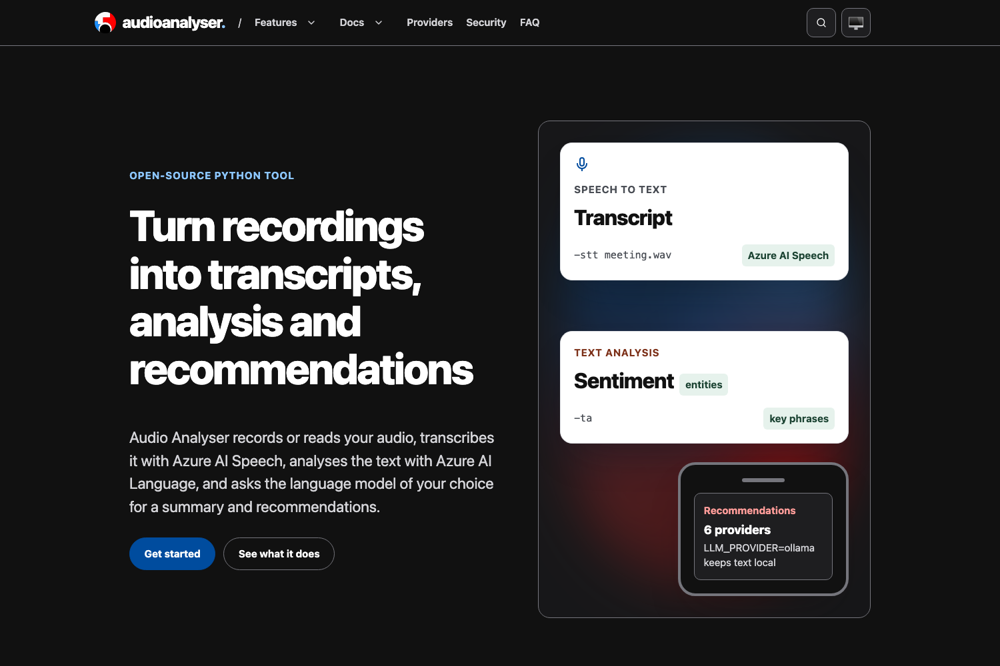

<!-- SPDX-License-Identifier: Apache-2.0 OR MIT -->
<!--
README template. Global rules: see ~/Code/AGENTS.md and ~/Code/REPO-STANDARD.md.
Releases adhere strictly to https://github.com/sebastienrousseau/passmcp/releases/tag/v0.0.5
-->

<p align="center">
  
</p>

<h1 align="center">Audio Analyser</h1>

<p align="center">
  A Python command-line tool and local dashboard that records audio, transcribes it with Azure AI Speech, analyses the text with Azure AI Language and writes recommendations with the language model you choose.
</p>

<p align="center">
  <a href="https://github.com/sebastienrousseau/audioanalyser.github.io/actions"></a>
  <a href="https://github.com/sebastienrousseau/audioanalyser.github.io/releases"></a>
  <a href="https://sebastienrousseau.com/audioanalyser.github.io/"></a>
  <a href="LICENSE-MIT"></a>
</p>

<p align="center">
  
</p>

---

## Contents

**Getting started**

- [Install](#install): from a clone of this repository
- [Requirements](#requirements): Python, PortAudio, Azure resources
- [Quick Start](#quick-start): record, transcribe, analyse, summarise

**The Audio Analyser ecosystem**

- [The Audio Analyser ecosystem](#the-audio-analyser-ecosystem): the application, its dashboard and its website

**Library reference**

- [Capabilities at a glance](#capabilities-at-a-glance): the commands by task
- [Ecosystem comparison](#ecosystem-comparison): not published
- [Benchmarks](#benchmarks): not published
- [Features](#features): modules
- [Configuration](#configuration): environment variables
- [Examples](#examples): command examples

**Operational**

- [When not to use Audio Analyser](#when-not-to-use-audio-analyser): limitations
- [Development](#development): tests, linters, the website build
- [Security](#security): where data goes, reporting
- [Documentation](#documentation): where each part is described
- [Stability guarantees](#stability-guarantees): versions and URLs
- [License](#license)

---

## Install

### As a Python application

```bash
git clone https://github.com/sebastienrousseau/audioanalyser.github.io.git
cd audioanalyser.github.io
python -m venv .venv && . .venv/bin/activate
pip install -r requirements.txt
cp env.example .env   # then fill in your keys and folders
```

`requirements.txt` pins every dependency with hashes. The `audioanalyser`
package on PyPI is version 0.0.6 from February 2024 and predates the
recommendation providers, so install from a clone.

---

## Requirements

- **Python** 3.10 or newer; CI runs on 3.10.
- **PortAudio**, for PyAudio (`portaudio19-dev` on Debian and Ubuntu).
  PyAudio publishes wheels for Windows only.
- **Azure resources**: Speech, Language, and Translator if you translate.
- **A recommendation provider**: an OpenAI, Anthropic or Gemini key, a
  local Ollama server, or a signed-in Claude Code or Agy CLI.

---

## Quick Start

```bash
python -m audioanalyser -rec              # record ten seconds
python -m audioanalyser -stt meeting.wav  # transcribe with Azure AI Speech
python -m audioanalyser -ta               # analyse every transcript
python -m audioanalyser -sum              # summaries and recommendations
python -m audioanalyser -s                # dashboard on http://127.0.0.1:8080/
```

---

## The Audio Analyser ecosystem

| Component | Purpose | Use case |
| :--- | :--- | :--- |
| `audioanalyser/` | The Python application and its command line | Processing recordings |
| `dashboard/` | The web UI the `-s` server serves on port 8080 | Working from a browser |
| `_posts/`, `_layouts/` | The website, built with Static Site Generator and the Prism theme | Changing the website |

---

## Capabilities at a glance

| Task | Command | Service | Output |
| :--- | :--- | :--- | :--- |
| Record | `-rec [settings.json]` | Local microphone | `INPUT_FOLDER` |
| Transcribe | `-stt <file>` | Azure AI Speech | `TRANSCRIPTS_FOLDER`, SQLite |
| Analyse | `-ta` | Azure AI Language | `REPORTS_FOLDER`, SQLite |
| Recommend | `-sum` | `LLM_PROVIDER` | `RECOMMENDATIONS_FOLDER` |
| Translate | `-t <codes...>` | Azure AI Translator | `TRANSLATIONS_FOLDER` |
| Speak | `-tts <text> <name>` | Azure AI Speech | `RECORDS_FOLDER` |
| Dashboard | `-s` | Local server | Port 8080 |

---

## Ecosystem comparison

Not published: no comparison with other tools has been measured.

---

## Benchmarks

Not published: no benchmarks have been measured.

---

## Features

- `audio_recorder`: microphone recording with PyAudio; mono, 16-bit,
  44.1 kHz and ten seconds by default.
- `transcribe_audio_files`: continuous recognition with Azure AI Speech;
  text, JSON and SQLite output.
- `analyze_text_files`: sentiment, entities, key phrases and language with
  Azure AI Language.
- `azure_recommendation` and `llm_providers`: summaries and
  recommendations from `openai` (default), `anthropic`, `gemini`,
  `ollama`, `claude-cli` or `agy-cli`.
- `azure_translator` and `text_to_speech`: Azure AI Translator and speech
  synthesis.
- `speech_text_server`: a CherryPy server for the dashboard and its HTTP
  endpoints.

---

## Configuration

Settings are environment variables, normally in a `.env` file;
`env.example` documents most of them. The full list, by module, is on the
website's [reference page](https://sebastienrousseau.com/audioanalyser.github.io/documentation/).
`LLM_PROVIDER` picks the recommendation backend and `LLM_MODEL` overrides
its default model.

---

## Examples

```bash
python -m audioanalyser -rec settings.json
python -m audioanalyser -t fr de
python -m audioanalyser -tts "hello" greeting
LLM_PROVIDER=ollama python -m audioanalyser -sum
```

---

## When not to use Audio Analyser

- **Offline transcription.** Transcription, analysis, translation and
  speech all call Azure; only recommendations can stay local, with Ollama.
- **A shared or public server.** The dashboard has no authentication.
- **A one-command pipeline.** Each run performs one task.

---

## Development

```bash
pip install -r requirements.txt pytest pytest-cov flake8 pylint bandit
pytest                                  # 95% coverage floor
flake8 && pylint audioanalyser/ && bandit -c .bandit.yml -r audioanalyser/
```

The tests stub PyAudio when PortAudio is missing and deselect the live
Ollama tests (`pytest -m integration` runs them).

The website:

```bash
make build       # contrast, ssg build, anchors, post-build checks, og images, ssg audit
make serve       # build and serve on http://127.0.0.1:8000/audioanalyser.github.io/
make screenshot  # render static/images/screenshot.png from the build
```

`make build` needs ssg 0.0.69 or newer, Python 3.11 or newer and Chrome or
Chromium (set `CHROME`). `.github/workflows/ci.yml` tests and lints the
application; `quality-gate.yml` builds the website on pull requests and
`pages.yml` builds and deploys it from `main`.

---

## Security

Audio goes to Azure AI Speech, and transcripts to Azure AI Language, Azure
AI Translator and the recommendation provider you choose; results stay in
local folders and SQLite. Keys live in `.env`, which `.gitignore`
excludes. The website carries a strict Content Security Policy and
Subresource Integrity hashes, checked on every build.

Report vulnerabilities according to [`SECURITY.md`](SECURITY.md).

---

## Documentation

- The website: <https://sebastienrousseau.com/audioanalyser.github.io/>
- Environment variables: [`env.example`](env.example)
- Releases: <https://github.com/sebastienrousseau/audioanalyser.github.io/releases>
- Third-party licences for the website theme: [`LICENSES/`](LICENSES/)

---

## Stability guarantees

Releases are tagged `v0.0.x` and step by 0.0.1; any release may change the
command line or configuration. The website keeps the page URLs that still
have content: `/about/`, `/accessibility/`, `/contact/`, `/documentation/`,
`/features/`, `/made-with-ssg/`, `/privacy/` and `/terms/`, under
`https://sebastienrousseau.com/audioanalyser.github.io/`.

---

## License

The source is available under [Apache-2.0](LICENSE-APACHE) or
[MIT](LICENSE-MIT), at your option. The Prism theme files in `_layouts/`
are MIT-licensed; see [`LICENSES/`](LICENSES/). The logo in
`static/logo.svg` is Audio Analyser's, from
`cloudcdn.pro/audioanalyser/v1/logos/audioanalyser.svg`.
